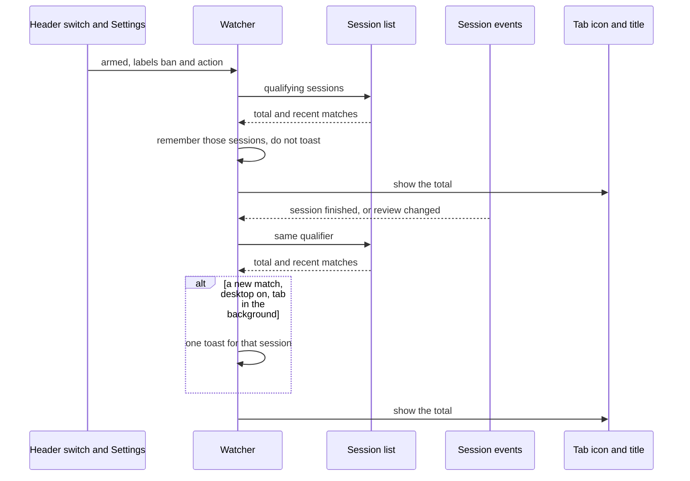

# ADR-0034: Browser Notifications

**Status:** Implemented
**Date:** 2026-10-29
**Relates to:** [ADR-0031](0031-session-labels.md) (session labels; label policy stays with the client)

## Overview

An SRE who leaves the TARSy dashboard in a browser tab can see how many completed sessions are still waiting for review, and can get a desktop toast when a new one appears while that tab is in the background. Both signals use one label filter. On a fresh browser the filter is `ban` and `action`, and both signals are on.

The toast and the counter run only while a dashboard tab is open. Closing the last tab stops both until the dashboard is opened again. Slack terminal messages stay as they are. This does not page anyone and does not post anywhere.

[ADR-0031](0031-session-labels.md) leaves label policy to the client. This feature is that client: it matches the names the user selected, and the default chips are only a starting selection.

## Design Principles

1. **The saved selection is the policy.** Defaults are the chips `ban` and `action`. After that, matching uses only what is selected, including a typed name. Dashboard chip colors are not an input.
2. **Both signals start on.** A fresh browser shows the counter and will toast once notification permission is granted. Opening the dashboard asks for that permission while desktop notifications are on and the browser has not been asked.
3. **Same qualifier for the counter and the toast.** The counter is the size of the set. The toast fires when a new member appears while the tab is in the background.
4. **The session list is the source of truth.** Session and review events wake a refresh. They are not themselves the notification. Labels stay off the websocket payload, as [ADR-0031](0031-session-labels.md) decided.
5. **Independent of the Sessions and Triage filters.** Those panels narrow what the page shows. Notification settings follow the user across routes.
6. **Any open dashboard tab is enough.** The watcher lives in the app shell, so a tab left on a session page still counts and can toast.

## Decisions

| # | Topic | Decision | Rationale |
|---|-------|----------|-----------|
| Q1 | Delivery channel | Toasts and the counter run only while a dashboard tab is open, through the page Notification API. The tab icon and the title carry the counter. | The dashboard already has the websocket and the session list, and it has no service worker. The tab icon requires the tab. A service-worker toast does not change the experience while that tab stays open. Web Push (subscriptions and VAPID) covers a machine with no dashboard tab, which Slack already reaches. Most mobile browsers throw on the Notification constructor; the counter still works there. |
| Q2 | Where settings live | This browser, with the other dashboard preferences. | Login is optional, so the server has no user id and no preference API. A personal choice on a shared wallboard stays on that browser. A second browser, or a cleared profile, starts from the defaults. Rejected: a per-user preference API, and a deployment YAML label list (that would put paging policy in TARSy config). |
| Q3 | Which sessions qualify | `status` is `completed` and `review_status` is `needs_review`. | A finished investigation that nobody has claimed. Claiming, acknowledging, or completing the review takes it out of the set. Failed and timed-out runs enter `needs_review` too, and they stay a Triage signal. Cancelled sessions are stored as `reviewed`. Rejected: also counting `in_progress` (the number would stay up after someone has taken the session) and also counting failed or timed-out runs. |
| Q4 | Label field | One autocomplete. Default chips `ban` and `action`. **Any label** and **No label** are choices in that field. An empty field matches nothing. | Names combine with OR. **No label** stacks with names. **Any label** replaces specific names, and a specific name replaces **Any label**. **Any label** together with **No label** means every qualifying session. Suggestions are the label-map catalog plus names already stored on sessions, and the field accepts a typed token in the existing label form (`[A-Za-z][A-Za-z0-9_-]*`). The builtin catalog is `watch`, `action`, and `noise`; `ban` is still the default chip because a custom name is allowed, and it matches only when a session stores that name. `label=` could not express unlabeled sessions or any non-empty labels, so the list gains `label_scope`. The watcher uses the list total and does not download the backlog to filter it locally. Rejected: empty means every session (the default would not be `ban` and `action`), empty means off (unlabeled sessions could never match), and a separate All / Only-these control. |
| Q5 | What the counter counts | The live backlog, including sessions that finished before the tab opened. | The number is `total_items` for the qualifier. It drops when a session is claimed or reviewed, including from another machine, and focusing the tab does not clear it. `100` and above display as `99+` on the icon and as the real total in the title and on the header control. A backlog of zero leaves the icon, the title, and the header control unmarked. The [Badging API](https://developer.mozilla.org/en-US/docs/Web/API/Badging_API) marks an installed app icon and does not show a number on a normal browser tab, including Chromium on Linux. Rejected: clear the number on focus, and a dot with no number. |
| Q6 | How the switches relate | Tab counter and desktop notifications are separate switches, both on by default. A header master switch, also on by default, suspends or resumes both. | The master switch sits immediately before the theme switch. It does not edit the label field or the two signal switches. Off clears the counter, and Settings shows both signal switches off while that pause lasts. On resumes the saved settings, including a choice that left one signal off. Opening the dashboard requests notification permission when desktop notifications are on and the browser has not been asked. Turning the master switch from off to on requests permission when desktop notifications are part of the saved configuration and the browser has not been asked. Settings can request it too, and can restore the default switches and label selection. If the user denies permission, the desktop signal stays on and Settings says the browser is blocking toasts. The counter does not need this permission. Rejected: one switch only (no way to keep the counter while muting toasts). |
| Q7 | When a toast fires | A new match, and only while the tab is in the background. | Subscribing replays recent stored events that look like live ones, so the list decides what is new. The first result after the watcher arms, after the label field changes, or after the master switch is turned back on sets the counter and the memory. A session already remembered does not toast again, including when it reopens. The counter still updates while the tab is focused and still tracks the full queue. A session that completes while the user is looking at another TARSy route in the same tab updates the counter and does not toast. Rejected: also toast while the tab is focused, and one summary toast for the backlog that already exists when the watcher arms. |
| Q8 | Toast content | One toast per session. The title carries the alert type and the labels. The body is the executive summary, shortened to about 180 characters. Activating the toast opens that session. | The list row already returns those fields. The title still identifies the session when the alert type is missing. The body is omitted when there is no summary. A later toast for the same session replaces the earlier one. The summary is incident text in the OS notification list. Rejected: title and labels only, and one coalesced toast for a burst. |
| Q9 | Where fine-tuning lives | A Settings page in the left nav. | The header control only suspends or resumes. The two signal switches, the label field, and the permission state need a page that is reachable on every route when login is not configured. The user menu is hidden in that case. Rejected: a menu on the header control, and the user menu. |
| Q10 | Several open tabs | Every tab draws the counter. The tabs share one announcement per session. | Each tab has its own icon and title, and both receive the same wake-up. The shared memory is written before the toast is constructed. A rare race where both tabs pass that check before either records the session is acceptable. Rejected: every tab toasts, and running the watcher only on the session list and Triage (a session-detail tab would go silent). |

## Architecture

The watcher subscribes for itself for as long as a signal is armed. The session list and the session-detail pages do not keep a global session subscription, and the Usage page listens only while it is open.

A finished session (`session.status` with `completed`) or a review change wakes one refresh. Progress and scoring events do not. A replayed backlog becomes one refresh, and sessions already remembered do not toast.

The counter is the full number of matches, including sessions beyond the ones returned in the recent page. Remembered sessions are shared by the tabs in this browser. Reopening a remembered session raises the counter and does not toast. Reopening one that was never remembered can toast.

If the list request fails, the previous count and memory stay until the next wake-up. Soft-delete does not emit a session event. The list already hides those rows, so the count catches up on the next refresh.

If the browser cannot show a page notification, the toast is skipped and the counter still works.

### Qualifier

A session counts when all of these hold:

- `status` is `completed`
- `review_status` is `needs_review`
- the label field matches

| Choice | Match |
|---|---|
| **Any label** | the session has one or more labels, whatever the names are |
| **No label** | the session has no labels (`null` or `[]`) |
| A name | the session's labels contain that name |

Names combine with OR. **No label** combines with names. **Any label** replaces specific names, and choosing a specific name replaces **Any label**. **Any label** together with **No label** means every qualifying session. An empty field matches nothing: the count is 0 and nothing toasts.

The default selection is `ban` and `action`, without **No label**. A browser with no saved settings gets the defaults. A saved empty selection stays empty. Unreadable saved settings fall back to the defaults.

### List query

`GET /api/v1/sessions` already returns `total_items` and each row's alert type, executive summary, labels, and review status. `label=` ORs comma-separated canonical names and does not match `null` or `[]`. Stored names are canonical, so `Action` does not match `action`. An invalid token is rejected.

`label_scope` adds the cases `label=` cannot express. Sessions and Triage keep the label filtering they have today and do not send `label_scope`.

| Query | Match |
|---|---|
| `label` omitted, `label_scope` omitted | no label predicate |
| `label=ban,action` | labels contain `ban` or `action` |
| `label_scope=any` | non-empty labels array. `label` must be empty |
| `label_scope=none` | `null` or `[]`. `label` must be empty |
| `label=ban,action&label_scope=names_or_none` | those names, or unlabeled. `label` is required |

An unknown `label_scope`, `any` or `none` together with `label`, or `names_or_none` without `label`, is a 400.

The watcher asks for `status=completed` and `review_status=needs_review` plus the label predicate above. **Any label** together with **No label** omits both `label` and `label_scope`. An empty field does not call the list.

### Controls

| Field | Default | Where |
|---|---|---|
| Master switch | on | App header, immediately before the theme switch. Shows the backlog count while the counter is on. |
| Tab counter | on | Settings |
| Desktop notifications | on | Settings |
| Label selection | `ban`, `action` | Settings |

Settings is in the left nav and is available when login is not configured. It also shows whether the browser has granted, denied, or not yet been asked for notification permission, offers a way to allow notifications while the browser has not been asked, and can restore the default switches and label selection.

Shown when the master switch and the tab-counter signal are both on. Otherwise the tab icon and the title return to the plain TARSy mark. The header control shows the same total as the title. A zero backlog is unmarked. The number changes when the set of qualifying sessions changes.

## Core Concepts

| Concept | Role |
|---|---|
| **Qualifier** | Completed, still needing review, and the label field. One predicate feeds the counter and the toast. |
| **Backlog count** | How many sessions match right now. This is the tab number. |
| **Remembered sessions** | Sessions already announced, or present when the watcher last armed. Shared in this browser. New matches are the only toast candidates. |
| **Master switch** | Header on/off. Suspends or resumes both signals without editing Settings. |
| **Watcher** | App-shell listener. Turns session and review events into one refresh of the qualifier. Runs while the master switch is on and at least one signal is on. |
| **Tab indicator** | A number on the tab icon, the same number in the title, and the same number on the header switch. |
| **Desktop notification** | One OS toast for a new match, and only while the tab is in the background. Activating it opens that session. |

## Out of Scope

- A service worker, VAPID keys, or stored push subscriptions.
- Changes to Slack terminal messages.
- Paging, or posting the backlog anywhere outside this browser.
- A deployment-wide label list.
- Changes to the Sessions and Triage filters.
- Labels on the websocket payload.

## Future Considerations

- Web Push, if a toast is needed after the last dashboard tab closes. Slack already covers that case.
- Server-side preferences, if login becomes required and a label selection should follow the person across browsers.

## References

- [ADR-0031: Session Labels](0031-session-labels.md) — stored labels, `label=` containment, and the decision to keep labels off the websocket payload
