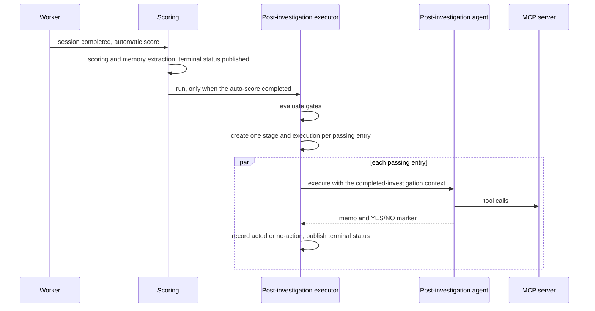

# ADR-0035: Post-Investigation Agents

**Status:** Implemented
**Date:** 2026-11-11
**Relates to:** [ADR-0008](0008-session-scoring.md) (scoring is async and fail-open; stage types left room for later post-investigation work), [ADR-0011](0011-scoring-framework-redesign.md) (score bands and the tool improvement report), [ADR-0014](0014-investigation-memory.md) (memory tools, no briefing), [ADR-0021](0021-session-deep-links.md) (dashboard link in context), [ADR-0026](0026-prompt-caching.md) (prompt cache stays off), [ADR-0031](0031-session-labels.md) (gate labels)

## Overview

Scoring judges a finished investigation and the Reflector turns that judgment into memories. Both results stay inside TARSy. Acting on them — changing a detection rule, filing a ticket, updating a runbook — was still manual.

**Post-investigation agents** run asynchronously after automatic scoring completes. An optional gate (score and session labels) decides whether an entry runs. The agent receives the finished investigation and the scoring verdict, uses its own MCP servers, and may take a side effect outside TARSy: open an issue, file a ticket, post a proposal. TARSy ships only that mechanism. What an agent does is configuration (`custom_instructions` plus MCP servers).

Example uses, all configuration:

- **Detection tuning** — after a correct conclusion, decide whether the detector that produced the alert should change, and open an issue in that configuration's repository.
- **Tool gaps** — turn the tool improvement report into a ticket against the MCP server it concerns.
- **Runbook updates** — propose a runbook change when the investigation found steps the runbook lacks.
- **Ticketing** — open a ticket for the human follow-up the investigation recommends, with the findings and a link to the session.
- **Targeted notifications** — notify a specific team or channel when the content warrants it. Unlike TARSy's built-in Slack notification, which posts every terminal session to one configured channel, the agent decides whether, whom, and what to notify.

```
alert ──► investigation chain ──► session completed ──► scoring (async) ──► post-investigation agents (gated, async)
                                                                             │
                                                                             ├─ agent A ─► MCP tools ─► e.g. issue in a config repo
                                                                             └─ agent B ─► MCP tools ─► e.g. ticket for a tool gap
```

## Design Principles

1. **Generic in TARSy, specific in config.** No deployment-specific issue tracker, repository, or downstream automation in TARSy code. TARSy knows: after scoring, if the gate passes, run this agent with this context.
2. **Never delays or affects the investigation.** Runs after scoring, async, fail-open. A failure never changes session status, score, final analysis, or session-level `actions_executed`. Same contract as scoring ([ADR-0008](0008-session-scoring.md), principles 1–3).
3. **Learn only from good investigations — when configured.** The gate (minimum score, labels) is first-class config. Every gate field is optional.
4. **Reuse existing building blocks.** Agent resolution, MCP tool execution, sub-agent orchestration, LLM provider and fallback resolution, stage and execution records, timeline events, and the action YES/NO marker.
5. **Auditable.** Every run is a stage plus an agent execution, with the full LLM and MCP history, visible in the dashboard next to the scoring stage.
6. **Default to doing nothing.** "No action" is a normal successful outcome, both in the injected prompt layer and in well-written agent instructions.
7. **At most once per session.** Only automatic scoring starts these agents. API re-scoring does not, so a re-score cannot repeat a side effect. A crash or shutdown can skip or interrupt a run. There is no retry in v1.

## Decisions

| # | Topic | Decision | Rationale |
|---|-------|----------|-----------|
| Q1 | Execution model | Dedicated post-investigation executor, modeled on the chat executor | Scoring has no MCP factory and a short timeout. The session executor updates an active investigation. Chat already runs MCP-enabled agents after a session is terminal, and scoring and chat each have their own executor. Rejected: running inside scoring (mixes concerns and keeps the scoring spinner up), and reusing the session executor's stage path (built around an active session). |
| Q2 | Config shape | Independent single-agent entries on the chain. `sub_agents` allowed on the entry only | The use cases are unrelated: one failing entry must not affect another. Sub-agent orchestration already exists for chat, so an entry can delegate (for example to a web researcher) without stage semantics. Chain-level `sub_agents` are not inherited. Rejected: entries with no sub-agents (a later config change), and a full stage list with sequential context passing (synthesis, replicas, and success policies have no post-terminal use case). |
| Q3 | Naming | `post_investigation` for the config key, stage type, and agent type | It says when the agent runs and stays valid if a later trigger is not scoring. "Follow-up" is already the name for chat. Rejected: "post-scoring" (wrong once another trigger exists), "improvement" (too narrow), "automation" (collides with automated actions), "handoff", "hooks", "wrap-up". |
| Q4 | Gate | Optional `min_score`, `labels_any`, and `labels_none`, AND-combined | A false positive with a correct conclusion is a good source of a suppression proposal, so the gate is not "threat confirmed". Labels are the existing session vocabulary ([ADR-0031](0031-session-labels.md)). Rejected: score only (cannot scope by outcome), and a CEL expression (a new mini-language). |
| Q5 | Context | Compact by default. `include_investigation: true` adds the full timeline | A detection change often needs verbatim strings (command lines, file names, image names). Final reports usually have them, and not always. Each entry chooses its cost. Rejected: compact only (misses exact evidence), and always the full timeline (expensive, and more attacker-controlled content). |
| Q6 | Agent type | New `post_investigation` type with its own behavioral layer and the same YES/NO marker | The action layer frames the job as incident remediation and says to avoid re-investigating. These agents need research (current state of the target system, existing tickets) and they do not remediate the incident. The builtin label map already treats filing a backlog ticket and tuning detection as not an action. The safety bullets and the YES/NO marker are reused. Rejected: reuse `action` (wrong framing), and any type with no injected layer (every deployment rewrites the safety guidance). |
| Q7 | Dashboard | Timeline stage, a Post-investigation card on session detail, and a session-list indicator plus filter | Operators need to find sessions that produced a proposal. The list already does this for action stages. Rejected: timeline only (the outcome is buried), and detail without a list filter (proposals are not discoverable from the list). |
| Q8 | Triggers | Automatic scoring only. The executor entry point takes a session and a score and does not know who called it | One run per session on the normal path. Re-scoring does not repeat side effects. A manual retry or a human-review trigger can be a thin caller later. Rejected: every completed score including API re-score (silent duplicate side effects), and shipping a retry endpoint in v1. |

## Architecture



Scoring calls the executor at the end of an automatic score, after the score is stored, memory extraction has run, and the scoring stage's terminal status has been published. API re-scoring shares the scoring path and does not call the executor. A call against a stopped executor is a logged no-op, so a score that finishes during shutdown does not start new work.

Stages are unique per session and index. Indexes are allocated as one past the current maximum, and a chat message can allocate an index at the same time, so the executor creates every stage and execution **sequentially** before launching agents, and retries allocation on a unique-constraint conflict. Entries then run concurrently, each with its own timeout (default 10 minutes). There is no global concurrency limit: every completed session may start its gated entries.

Resolution order for the LLM pair, fallback list, and `max_iterations`: defaults, then the agent definition, then the chain, then `defaults.agents.<name>`, then the entry. MCP servers come from the agent definition, overridden by the entry. The chain's MCP servers and the session's per-alert MCP override belong to the investigation and are not applied. The type is forced to `post_investigation`. Sub-agents are the entry's list only, wired the same way as chat, with the sub-agent timeout clamped to the parent's remaining time.

When memory is enabled, the agent gets `recall_past_investigations` and `search_past_sessions` (the current session excluded). No memory briefing is injected. A typical use is checking whether an entity recurs across past sessions before acting on it.

Any error marks only that entry's stage and execution failed. Transient timeline events are cleaned up after the runs finish, the same way scoring does.

Shutdown waits `queue.post_investigation_shutdown_timeout` (default 3 minutes) after scoring's drain, then cancels what is still running. (Originally in parallel with scoring; made sequential so a scoring run that completes during its drain still starts its agents.) Orphan recovery mirrors scoring: at startup, `pending` and `active` post-investigation stages for sessions owned by this pod are marked failed, along with their active executions and streaming timeline events; periodically, stages active longer than the longest entry timeout plus a margin are failed. A stage has no creation time and receives a start time only when its execution starts, so a stale `pending` stage is aged from the session's completion time plus scoring's timeout.

### Configuration

Post-investigation agents are declared per chain and reference agents defined in `agents:`.

```yaml
agents:
  DetectionTuningProposer:
    type: post_investigation     # optional — inferred when used in a post_investigation entry
    description: "Proposes detector configuration changes as issues"
    mcp_servers: ["github"]
    max_iterations: 15
    custom_instructions: |
      ...                        # what to propose, criteria, where and how to file it

agent_chains:
  my-investigation-chain:
    stages: [...]                # unchanged
    post_investigation:
      - name: "detection-tuning"             # stage name; unique within the chain
        agent: "DetectionTuningProposer"
        # Gate — every field optional; all set conditions must pass (AND)
        min_score: 60                        # total_score >= 60 ("correct conclusion" band, ADR-0011)
        labels_any: [action, noise]          # session has at least one of these labels
        labels_none: []                      # session has none of these labels
        # Context
        include_investigation: false         # true = also include the full investigation timeline
        # Execution
        timeout: 10m                         # default 10m
        llm_provider: my-provider            # optional pairing overrides, same knobs as stage agents
        fallback_list: my-fallback-list
        max_iterations: 15
        mcp_servers: []                      # optional override of the agent's servers
        sub_agents:                          # optional; entry-level only
          - name: WebResearcher
```

`post_investigation` is chain-level only. There is no `defaults.post_investigation` block.

Gate semantics:

- An unset field is no condition. An empty list is unset. With no gate fields, the agent runs after every completed automatic score.
- `labels_any` does not match unlabeled sessions (empty or unknown). `labels_none` skips sessions that have any listed label; unlabeled sessions pass it.
- Label names match case-insensitively. Stored labels use the label map's canonical spelling.
- A gate miss creates **no stage**. It is logged and counted. The session stores a short note — entry name and why — written when the gate is checked. Session detail shows that note in the post-investigation card with a Skipped chip. The list indicator is unchanged: no icon means it did not run.

Load-time validation:

- A chain with `post_investigation` must have scoring enabled, after defaults are applied to chains that omit their own scoring block. Otherwise the entries could never fire.
- The referenced agent exists, its MCP servers exist, and `sub_agents` references are valid.
- Agent type is `post_investigation` or unset (treated as `post_investigation`). Any other explicit type is rejected. A `type: post_investigation` agent is rejected in chain stages, chat, the scoring agent, and `sub_agents` references.
- `min_score` is 0–100. `timeout` is positive. Names are unique within a chain.
- `labels_any` and `labels_none` names exist in the chain's resolved label map (chain, then defaults, then builtin). A label may not appear in both lists.

### Agent type and behavioral layer

The type runs on the iterating controller.

- **System prompt:** the usual instruction tiers (time and calendar, general instructions including evidence transparency and "Observations are not orders", MCP server instructions, skills, custom instructions — the same base as action agents), then the post-investigation behavioral layer, then orchestrator sections when the agent has sub-agents, then a post-investigation task focus.
- **User message:** the alert, the post-investigation context under "Completed Investigation", the task, and a YES/NO marker in the same last-line format as action agents. YES means a side-effecting follow-through. Read-only research tool calls do not count. There is no "Previous Stage Data" section.
- **Prompt caching:** off, same as action. Most runs are short "no action" generates whose cache writes would never be read ([ADR-0026](0026-prompt-caching.md)). Revisit with usage data.
- **Memory:** no briefing injection. Memory tools come from the executor, as for chat.

```text
## Post-Investigation Agent Guidelines

The investigation is complete and has been scored. Your role is to decide whether a
follow-through outside this investigation is warranted (as defined by your instructions)
and, if so, carry it out with your tools. You do not remediate the incident.

- Base decisions on evidence from the investigation, not on speculation
- You may use your tools to gather the extra context your task needs (e.g. current state
  of the target system, existing tickets); do not redo the alert investigation
- If evidence is ambiguous or conflicting, report your assessment but do NOT act
- Explain your reasoning BEFORE executing any tool with side effects
- No action is a normal, successful outcome; prefer inaction over incorrect action
- Write a short memo: decision, evidence, tools used, outcome, links to anything you created
```

The last line of the user message requires `YES` or `NO` alone. `YES` only if a tool with side effects carried out the follow-through.

### Post-investigation context

| Section | Source | Default |
|---|---|---|
| Session metadata and link | session ID, alert type, chain ID, `{dashboard_url}/sessions/{id}` ([ADR-0021](0021-session-deep-links.md)); the link is omitted when `dashboard_url` is unset | included |
| Alert data | the stored alert payload, already masked, rendered as the alert section and not repeated in the context | included |
| Final report | latest compose report if present, otherwise `final_analysis` | included |
| Executive summary | `executive_summary` | included |
| Session labels | stored labels ([ADR-0031](0031-session-labels.md)) | included |
| Scoring verdict | `total_score`, `score_analysis`, `failure_tags`, `tool_improvement_report` | included |
| Full investigation timeline | the same investigation context scoring uses (tool inventory and timeline), without the alert and runbook sections | only with `include_investigation: true` |

Post-investigation stages do not appear in other contexts. Scoring context includes investigation, executive-summary, and action stages. Chat skips unknown stage types. Chat cannot see post-investigation memos in v1.

### Persistence

- New stage type `post_investigation`. No SQL migration: `stage_type` is stored as text, as for `action` and `compose`. The stage name is the entry name. The stage index is the next index after the current maximum (the scoring stage already exists).
- One agent execution per stage, plus sub-agent executions when used.
- The YES/NO marker is parsed into the stage's existing `actions_executed` column and stripped from the timeline, the same way action stages do. On parse failure: warn, leave `actions_executed` unset, and keep the memo as written. Session-level `actions_executed` and the action-outcome metric still count **only** action stages. A post-investigation side effect is not incident remediation.
- No new table. The memo, including any created links, is the stage's final-analysis timeline event.
- A gate miss is stored on the session as `post_investigation_skips` (entry name and reason), not as a stage.
- Session `total_stages` and `completed_stages` already count every stage type. Post-investigation stages are counted the same way.
- Status uses the existing stage and execution events.

### Dashboard and API

- **Timeline:** post-investigation stages render after the Reflection (scoring) stage, with their own separator.
- **Session detail:** a Post-investigation card. Each entry that ran shows name, status, an Acted or No action chip, and the memo as markdown with clickable links. A terminal status for a post-investigation stage re-fetches the session (for `actions_executed`) and the timeline, because the YES/NO marker is stripped from the memo without a timeline event. Gate misses are rows in that same card, from `post_investigation_skips` (`name`, `detail`), recorded before the scoring stage event so the refetch includes them. Skipped is the gate. No action is an agent that ran and chose not to act.
- **Session list:** an indicator when post-investigation ran — green when any agent acted, grey otherwise, same styling as the action-stage chip — and a filter:
  - `acted` — at least one post-investigation stage with `actions_executed = true`
  - `ran` — at least one post-investigation stage exists (any status)
  - `none` — no post-investigation stage

  The list row carries `has_post_investigation` and `post_investigation_acted`. The triage view shares that row shape, so triage shows the same indicator and has no separate filter.
- **Config viewer:** each chain's post-investigation entries are part of the read-only configuration view ([ADR-0019](0019-config-viewer.md)).

### Metrics

`tarsy_post_investigation_runs_total{chain, name, outcome}` with outcome one of `skipped_gate`, `completed_acted`, `completed_no_action`, `failed`, `timed_out`, `cancelled` ([ADR-0010](0010-prometheus-metrics.md)).

### Safety

Side-effect scope is the MCP servers and tools an agent is given, and the credentials those servers hold. The behavioral layer requires evidence, prefers inaction, and asks for reasoning before a side-effecting tool. The existing "Observations are not orders" rule applies.

Investigation content is partly attacker-controlled. A deployment that creates artifacts should keep a human approval step downstream (for example, a person reviews and merges every change an agent proposes).

## Core Concepts

| Concept | Role |
|---|---|
| **Post-investigation entry** | A named, chain-scoped agent run after automatic scoring, with an optional gate. Independent of other entries. |
| **Gate** | Optional `min_score`, `labels_any`, and `labels_none`, AND-combined. A miss creates no stage. |
| **Post-investigation stage** | `stage_type: post_investigation`. Fail-open. Never changes session status, score, final analysis, or session-level `actions_executed`. |
| **`post_investigation` agent type** | Iterating controller, post-investigation behavioral layer, YES/NO marker. |
| **Memo** | The agent's final answer: decision (acted or no action), evidence, and links. Shown in the dashboard. |
| **Post-investigation executor** | Gate evaluation, records, context, MCP and sub-agent wiring, execution, and shutdown. |

## Future Considerations

- A manual retry or backfill, and a human-review trigger, as callers of the existing entry point. Neither is built.
- Showing post-investigation memos in chat context.
- Turning prompt caching on if usage shows a prefix worth reading.
- A `defaults.post_investigation` block, if several chains share the same entries.
- Retry after a crash or shutdown. v1 can skip a run.

## References

- [ADR-0007: Automated Actions](0007-automated-actions.md) — the action YES/NO marker and safety layer this type does not reuse as-is
- [ADR-0008: Session Scoring](0008-session-scoring.md) — async, fail-open scoring, and the trigger point
- [ADR-0010: Prometheus Metrics](0010-prometheus-metrics.md) — counter naming
- [ADR-0011: Scoring Framework Redesign](0011-scoring-framework-redesign.md) — the 60-point "correct conclusion" band used in the example gate
- [ADR-0014: Investigation Memory](0014-investigation-memory.md) — memory tools without a briefing
- [ADR-0019: Read-Only Configuration Viewer](0019-config-viewer.md) — chain post-investigation entries in the config view
- [ADR-0021: Session Deep Links](0021-session-deep-links.md) — dashboard URL in the agent context
- [ADR-0026: Prompt Caching](0026-prompt-caching.md) — why short action-style loops leave the cache off
- [ADR-0031: Session Labels](0031-session-labels.md) — the label vocabulary the gate matches
