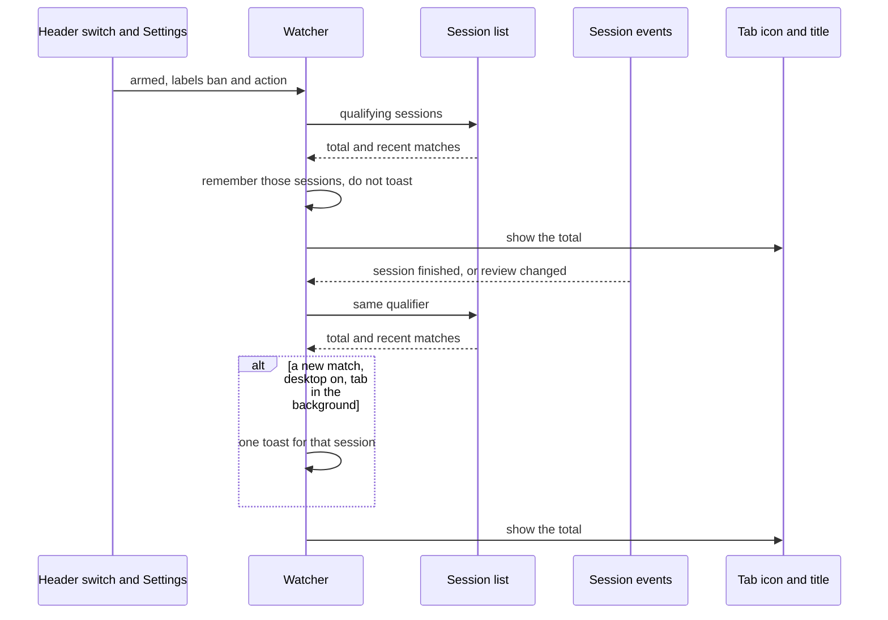

# Browser notifications — Design

**Status:** Final — decisions in [browser-notifications-questions.md](browser-notifications-questions.md)

## Overview

An SRE who leaves the TARSy dashboard in a browser tab can see how many completed sessions are still waiting for review, and can get a desktop toast when a new one appears while that tab is in the background. Both signals use one label filter. On a fresh browser the filter is `ban` and `action`, and both signals are on.

The toast and the counter run only while a dashboard tab is open. Closing the last tab stops both until the dashboard is opened again. Slack terminal messages stay as they are. This does not page anyone and does not post anywhere.

[ADR-0031](../adr/0031-session-labels.md) leaves label policy to the client. This feature is that client: it matches the names the user selected, and the default chips are only a starting selection.

## Design Principles

1. **The saved selection is the policy.** Defaults are the chips `ban` and `action`. After that, matching uses only what is selected, including a typed name. Dashboard chip colors are not an input.
2. **Both signals start on.** A fresh browser shows the counter and will toast once notification permission is granted. Loading the page does not ask for that permission.
3. **Same qualifier for the counter and the toast.** The counter is the size of the set. The toast fires when a new member appears while the tab is in the background.
4. **The session list is the source of truth.** Session and review events wake a refresh. They are not themselves the notification. Labels stay off the websocket payload, as [ADR-0031](../adr/0031-session-labels.md) decided.
5. **Independent of the Sessions and Triage filters.** Those panels narrow what the page shows. Notification settings follow the user across routes.
6. **Any open dashboard tab is enough.** The watcher lives in the app shell, so a tab left on a session page still counts and can toast.

## Architecture / How It Works

### What this builds on

- The dashboard has no service worker. Desktop toasts use the page Notification API. The [Badging API](https://developer.mozilla.org/en-US/docs/Web/API/Badging_API) marks an installed app icon and does not show a number on a normal browser tab, including Chromium on Linux. The tab icon and the tab title are the counter people actually see.
- The session list and the session-detail pages do not keep a global session subscription across the whole app. The Usage page listens only while it is open. The watcher subscribes for itself for as long as a signal is armed.
- Subscribing replays recent stored events, and those payloads look the same as live ones. Treating every replayed status as a new session would toast history. The list, not the replay, decides what is new.
- Completed, failed, and timed-out sessions enter `needs_review`. Cancelled sessions are stored as `reviewed`. Claiming, acknowledging, or completing a review takes a session out of `needs_review`.
- The session list already returns a total count and each row's alert type, executive summary, labels, and review status. It can filter by status, review status, and label. A label filter matches any of the given names and does not match `null` or `[]`. It cannot yet express "these names or unlabeled" or "any non-empty labels." Stored names are canonical, so `Action` does not match `action`.
- Label suggestions already exist in two places: names stored on sessions, and the label-map catalog (including names no session has used). The builtin catalog is `watch`, `action`, and `noise`. It does not define `ban`.
- Other dashboard preferences live in this browser. There is no per-user preference API. Login is optional.

### Qualifier

A session counts when all of these hold:

- `status` is `completed`
- `review_status` is `needs_review`
- the label field matches

The label field is one control on the Settings page. It suggests catalog names and names already stored on sessions, and it accepts a typed token in the existing label-token form. Two extra choices sit in that same control:

| Choice | Match |
|---|---|
| **Any label** | the session has one or more labels, whatever the names are |
| **No label** | the session has no labels (`null` or `[]`) |
| A name | the session's labels contain that name |

Names combine with OR. **No label** combines with names. **Any label** replaces specific names, and choosing a specific name replaces **Any label**. **Any label** together with **No label** means every qualifying session. An empty field matches nothing: the count is 0 and nothing toasts.

The default selection is `ban` and `action`, without **No label**. `ban` matches only when a session actually stores that name.

Notification settings persist in this browser, separate from the Sessions and Triage filters. A browser with no saved settings gets the defaults. A saved empty selection stays empty. Unreadable saved settings fall back to the defaults.

### List query

The session list gains whatever it needs to answer the qualifier, including unlabeled sessions and sessions with any non-empty labels. The watcher uses the total count for the tab number and does not download the whole backlog to filter it locally. Sessions and Triage keep the label filtering they have today.

### Runtime

The watcher lives in the app shell. It listens while the master switch is on and at least one signal is on.

A finished session or a review change wakes one refresh. Progress and scoring events do not. A replayed backlog becomes one refresh, and sessions already remembered do not toast.

The counter is the full number of matches, including sessions beyond the ones returned in the recent page. A session that starts matching while the watcher is armed is a toast candidate. The first result after the watcher arms, after the label field changes, or after the master switch is turned back on only sets the counter and the memory. It does not toast the queue that is already waiting.

Remembered sessions are shared by the tabs in this browser, so a refresh does not announce them again. Reopening a remembered session raises the counter and does not toast. Reopening one that was never remembered can toast.

If the list request fails, the previous count and memory stay until the next wake-up. Soft-delete does not emit a session event. The list already hides those rows, so the count catches up on the next refresh. No new event is required for that.

### Tab counter

Shown when the master switch and the tab-counter signal are both on. Otherwise the tab icon and the title return to the plain TARSy mark.

The icon shows the number, and `100` or more shows `99+` there. The title and the header control show the real total, including values past 99. Focusing the tab does not clear the number. The number changes when the set of qualifying sessions changes.

### Desktop notification

One toast per newly matching session, and only while this tab is in the background. The counter still updates when the tab is focused.

The title carries the alert type and the labels, and still identifies the session when the alert type is missing. The body is the executive summary, shortened to about 180 characters, and is omitted when there is no summary. A later toast for the same session replaces the earlier one. Activating the toast brings this tab forward and opens that session.

Tabs share the "already announced" memory, so two open tabs produce one toast. A rare race where both tabs pass that check before either records the session is acceptable.

If the browser cannot show a page notification, the toast is skipped and the counter still works.

Permission is asked from a user action, never from loading the page. Because the desktop signal defaults to on, the first visit does not itself ask. Settings offers a way to allow notifications while the browser has not been asked. Turning the header switch from off to on asks when desktop notifications are part of the saved configuration and the browser has not been asked. If the user denies permission, the desktop signal stays on and Settings says the browser is blocking toasts, without asking again. The counter does not need this permission.

### Controls

| Field | Default |
|---|---|
| Master switch | on |
| Tab counter | on |
| Desktop notifications | on |
| Label selection | `ban`, `action` |

The master switch is in the app header, immediately before the light/dark control. It only turns the feature on or off. Off suspends both signals and clears the counter. On resumes the saved settings, including a choice that left one signal off. While the counter is on, this control shows the backlog count.

The two signal switches, the label field, and the permission state are on a Settings page in the left nav. That page is available when login is not configured.

## Core Concepts

| Concept | Role |
|---|---|
| **Qualifier** | Completed, still needing review, and the label field. One predicate feeds the counter and the toast. |
| **Backlog count** | How many sessions match right now. This is the tab number. |
| **Remembered sessions** | Sessions already announced, or present when the watcher last armed. Shared in this browser. New matches are the only toast candidates. |
| **Master switch** | Header on/off. Suspends or resumes both signals without editing Settings. |
| **Watcher** | App-shell listener. Turns session and review events into one refresh of the qualifier. Runs while the master switch is on and at least one signal is on. |
| **Tab indicator** | A number on the tab icon, the same number in the title, and the same number on the header switch. |
| **Desktop notification** | One OS toast for a new match, and only while the tab is in the background. Activating it opens that session. |

## Implementation Plan

One change. It extends the session list so the qualifier can be queried, and adds the watcher, header switch, Settings page, tab counter, and desktop toasts described above.

The session list and Triage views keep their current filters. Labels stay off the websocket payload. There is no service worker.

Tests cover the list qualifier and the rules for when a session updates the counter or produces a toast. Driving a real OS notification from an end-to-end test is out of scope.

## Decisions

| # | Decision |
|---|---|
| Q1 | Toasts and the counter run only while a dashboard tab is open, through the page Notification API. |
| Q2 | Settings stay in this browser. |
| Q3 | Completed sessions that still need review. |
| Q4 | One label field. Default chips `ban` and `action`. **No label** and **Any label** are choices in that field. An empty field matches nothing. |
| Q5 | The number is the live backlog, including sessions that finished before the tab opened. |
| Q6 | Tab counter and desktop toasts are separate switches, both on by default. The header control before the theme switch suspends or resumes both without editing that configuration. |
| Q7 | Toast only for a new match while the tab is in the background. The counter still tracks the full queue. |
| Q8 | One toast per session: alert type, labels, and a short summary. Activating it opens that session. |
| Q9 | Fine-tuning is a Settings page in the left nav. |
| Q10 | Every tab draws the counter. The tabs share one announcement per session. |
