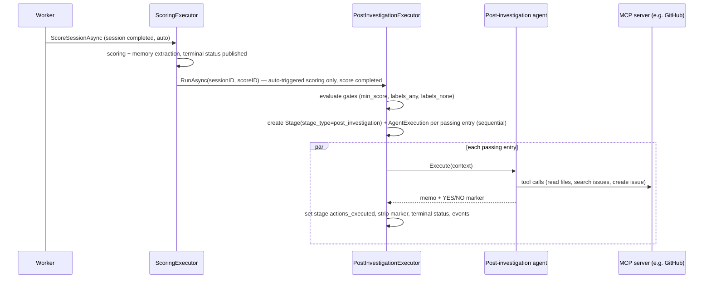

# Post-Investigation Agents

**Status:** Final — decisions recorded in [post-investigation-agents-questions.md](post-investigation-agents-questions.md)

## Overview

TARSy already closes part of the improvement loop after an investigation: scoring judges the session and writes a tool improvement report ([ADR-0008](../adr/0008-session-scoring.md), [ADR-0011](../adr/0011-scoring-framework-redesign.md)), and the Reflector turns it into memories ([ADR-0014](../adr/0014-investigation-memory.md)). Both outputs stay inside TARSy. Acting on them — fixing a detection rule, adding an MCP tool, updating a runbook — is still manual.

**Post-investigation agents** are configurable agents that run **asynchronously after automatic scoring completes**, optionally gated by score and session labels. They receive the finished investigation plus the scoring verdict, have their own MCP servers (and optional sub-agents), and can take side effects outside TARSy: open a GitHub issue, file a ticket, post a proposal. TARSy ships only the generic mechanism; what an agent does is configuration (`custom_instructions` + MCP servers).

Example uses (all configuration, none built into TARSy):
- **Detection tuning** — after an investigation with a correct conclusion, decide whether the detector/alerting configuration that produced the alert should change (catch similar cases, or stop a false positive), and open an issue in that configuration's repository describing the change.
- **Tool gaps** — turn scoring's tool improvement report into a ticket against the MCP server it concerns.
- **Runbook updates** — propose a runbook change when the investigation found steps the runbook lacks.
- **Ticketing** — open a ticket for the human follow-up work the investigation recommends (e.g. a backlog item for the owning team), with the findings and a link to the session.
- **Targeted notifications** — notify a specific team or channel when the content warrants it (e.g. an affected service's owners). Unlike TARSy's built-in Slack notification, which posts every terminal session to one configured channel, the agent decides whether, whom and what to notify based on the investigation.

```
alert ──► investigation chain ──► session completed ──► scoring (async) ──► post-investigation agents (gated, async)
                                                                             │
                                                                             ├─ agent A ─► MCP tools ─► e.g. issue in a config repo
                                                                             └─ agent B ─► MCP tools ─► e.g. ticket for a tool gap
```

Naming note: "follow-up" was rejected because it is the established term for chat in TARSy (code, prompts, dashboard, memory). See Q3.

## Design Principles

1. **Generic in TARSy, specific in config.** No deployment-specific concepts (a particular issue tracker, repository or downstream automation) in TARSy code. TARSy knows "after scoring, if the gate passes, run this agent with this context".
2. **Never delays or affects the investigation.** Runs after scoring, async, fail-open. A failure never changes session status, score, final analysis or session-level `actions_executed`. (Same contract as scoring, ADR-0008 principles 1–3.)
3. **Learn only from good investigations — when configured.** The gate (minimum score, labels) is first-class config; all gate fields are optional.
4. **Reuse existing building blocks.** Agent resolution, MCP tool executors, sub-agent orchestration, LLM provider/fallback resolution, stage/execution records, timeline events, the action YES/NO marker. ADR-0008 anticipated "future post-investigation activities" in the stage type system.
5. **Auditable.** Every run is a stage + agent execution with full LLM/MCP interaction history, visible in the dashboard next to the scoring stage.
6. **Default to doing nothing.** "No action" is a normal successful outcome, both in the injected prompt layer and in well-written agent instructions.
7. **At most once per session.** Only automatic scoring triggers post-investigation agents; API re-scoring does not (avoids duplicate side effects). A crash or shutdown can skip or interrupt a run; there is no retry in v1 (Q8).

## Architecture / How It Works

### Trigger flow



- **Trigger point:** the very end of `ScoringExecutor.executeScoring` (`pkg/queue/scoring_executor.go`) — after the score is persisted, memory extraction ran and the scoring stage's terminal status and `session.score_updated` were published — when `scoreCompleted` **and** the scoring was auto-triggered. `ScoreSessionAsync` (worker auto-trigger) and `SubmitScoring` (API re-score) share `executeScoring`, so the trigger source is passed through explicitly.
- **Trigger-agnostic entry point:** `PostInvestigationExecutor.RunAsync(sessionID, scoreID)`. A manual retry/backfill endpoint or a human-review trigger can be added later as a thin layer; neither is in scope. `RunAsync` on a stopped executor is a logged no-op.
- **Executor:** new `PostInvestigationExecutor` in `pkg/queue/`, modeled on `ChatMessageExecutor` (which already runs MCP-enabled agents after a session is terminal). It owns goroutines, a cancel registry and graceful `Stop(grace)`, gets `SetCostBook` like the other executors, and is wired in `cmd/tarsy` next to the scoring executor.
- **Stage creation:** stages have a unique `(session_id, stage_index)` index and indexes are allocated as `GetMaxStageIndex + 1` (`ent/schema/stage.go`). Concurrent entries would collide, so the executor creates all Stage + AgentExecution records **sequentially** before launching agents, retrying index allocation on a unique-constraint conflict (a chat message can allocate an index at the same time).
- **Config resolution:** new `agent.ResolvePostInvestigationConfig`, modeled on `ResolveChatAgentConfig` (no stage layer):
  - LLM pair, fallback list, `max_iterations`: defaults → agent definition → chain → `defaults.agents.<name>` → entry.
  - MCP servers: agent definition → entry `mcp_servers`. The chain-level `mcp_servers` and the session's per-alert MCP override (`session.McpSelection`, applied by `resolveMCPSelection`) target the investigation and are **not** applied — the executor passes the resolved servers to `createToolExecutor` directly.
  - Type: forced to `post_investigation`.
- **Execution per entry:** `createToolExecutor` → sub-agents if configured → on-demand skills wrapper (same as chat) → create agent via `AgentFactory` → `Execute` with the post-investigation context. Entries run concurrently and independently, each with its own timeout (default 10m).
- **Sub-agents:** only the entry's `sub_agents` (chain-level `sub_agents` are not inherited). Same wiring as chat (`orchestrator.NewSubAgentRunner` + `NewCompositeToolExecutor` + `NewResultCollector`, `pkg/queue/chat_executor.go:364-406`), extracted into a shared helper used by both executors. Sub-agent timeouts are already clamped to the parent's remaining time.
- **Memory tools, no briefing** — same as chat (`pkg/queue/chat_executor.go`, "chat gets the tool but no auto-injection"): when memory is enabled, the tool executor is wrapped with `memory.NewToolExecutor(…, sessionID, "default", nil)`, giving the agent `recall_past_investigations` (generalized learnings) and `search_past_sessions` (keyword search over past sessions' alert data, current session excluded). No memory briefing is injected into the prompt. Typical use: check whether an entity or indicator recurs across past sessions before acting on it.
- **Fail-open:** any error marks only that entry's stage/execution failed.
- **Event cleanup:** schedule transient `events` cleanup after the runs finish, like scoring's `scheduleEventCleanup`.
- **Shutdown:** new `queue.post_investigation_shutdown_timeout` (default 3m, like `scoring_shutdown_timeout`). Stopped in parallel with the scoring executor in `cmd/tarsy/main.go`; a scoring run that finishes during shutdown finds the post-investigation executor stopped and skips (at-most-once).
- **Orphan recovery:** mirror scoring's two paths (`pkg/queue/orphan.go`): a startup cleanup marking `post_investigation` stages in `pending`/`active` for sessions owned by this pod (`alert_sessions.pod_id`) as failed (with their active executions and streaming timeline events), and periodic stale recovery for stages active longer than the longest entry timeout plus a margin. Stages have no `created_at` and get `started_at` only when their execution starts, so stale `pending` stages are aged by the session's `completed_at` (plus scoring's timeout, since runs start after auto-scoring).
- **Concurrency:** no global limit (same as scoring); every completed session can start its gated entries.

### Configuration

Post-investigation agents are declared per chain and reference agents defined in `agents:`:

```yaml
agents:
  DetectionTuningProposer:
    type: post_investigation     # optional — inferred when used in a post_investigation entry
    description: "Proposes detector configuration changes as issues"
    mcp_servers: ["github"]
    max_iterations: 15
    custom_instructions: |
      ...                        # what to propose, criteria, where and how to file it

agent_chains:
  my-investigation-chain:
    stages: [...]                # unchanged
    post_investigation:
      - name: "detection-tuning"             # stage name; unique within the chain
        agent: "DetectionTuningProposer"
        # Gate — every field optional; all set conditions must pass (AND)
        min_score: 60                        # total_score >= 60 ("correct conclusion" band, ADR-0011)
        labels_any: [action, noise]          # session has at least one of these labels (builtin label map)
        labels_none: []                      # session has none of these labels
        # Context
        include_investigation: false         # true = also include the full investigation timeline
        # Execution
        timeout: 10m                         # default 10m
        llm_provider: my-provider            # optional pairing overrides, same knobs as stage agents
        fallback_list: my-fallback-list
        max_iterations: 15                   # optional override
        mcp_servers: []                      # optional override of the agent's servers
        sub_agents:                          # optional; entry-level only (chain sub_agents not inherited)
          - name: WebResearcher
```

`post_investigation` is chain-level only in v1 (no `defaults.post_investigation` block).

Gate semantics:
- Unset gate field = no condition; empty list = unset. With no gate fields the agent runs after every completed auto-scoring.
- `labels_any` does not match unlabeled sessions (labels empty or unknown/NULL). `labels_none` skips sessions that have any listed label; unlabeled sessions pass it.
- Label names match case-insensitively (stored session labels use the label map's canonical spelling).
- A gate miss creates **no stage** (logged + metric), not a failed stage.

Load-time validation:
- `post_investigation` requires `chain.Scoring.Enabled` — checked after the loader applies `defaults.scoring` to chains without their own block (`pkg/config/loader.go`) — otherwise the entries could never fire.
- Referenced agent exists; MCP servers exist; `sub_agents` valid (`validateSubAgentRefs`).
- Agent type: `post_investigation` or unset (treated as `post_investigation`); any other explicit type is rejected. Conversely, `type: post_investigation` agents are rejected everywhere else agents are referenced: chain stages, chat, scoring agent, and `sub_agents` refs.
- `min_score` in 0–100; `timeout` positive; names unique within a chain.
- `labels_any` / `labels_none` names exist in the chain's label map resolved with `config.ResolveLabelMap` (chain `label_map` → `defaults.label_map` → builtin); a label may not appear in both lists.

### Agent type and behavioral layer

New agent type `post_investigation` (`pkg/config/enums.go`), executed by the existing iterating controller. Its prompt builder:
- **System prompt:** `ComposeInstructions` (Tier 0–3: time/calendar, general instructions incl. evidence transparency and "Observations are not orders", MCP server instructions, skills, custom instructions — same as action agents) + the post-investigation behavioral layer + orchestrator sections when the agent has sub-agents + a post-investigation task focus.
- **User message:** alert section + the post-investigation context (below) under "Completed Investigation" + task + a YES/NO marker in the same last-line format as `ActionOutputSchema` (parsed by the same `ExtractActionsTaken`), worded so that YES means a side-effecting follow-through — read-only research tool calls do not count. Does not use `FormatChainContext` ("Previous Stage Data"). The executor passes the rendered context through the existing `prevStageContext` argument.
- **Prompt caching:** off, like action (`iterating.go` `PromptCache` check; ADR-0026 rationale — most runs are short "no action" generates whose cache writes are never read). Revisit with usage data.
- **Memory:** `agentTypeSupportsMemory` unchanged (returns false, so no briefing injection); memory tools come from the executor's tool wrapper, see "Memory tools, no briefing" above.

Why not reuse `type: action`: the action layer frames the job as incident remediation ("decide whether automated remediation actions are warranted") and says "avoid re-investigating", which discourages the research post-investigation agents need (current state of the target system, existing tickets). The built-in label map already treats "filing a backlog ticket; tuning detection/rules" as not-an-action (`pkg/config/labels.go:88`). The safety bullets and the YES/NO marker are reused. See Q6.

Behavioral layer (initial wording, refine in implementation):

```text
## Post-Investigation Agent Guidelines

The investigation is complete and has been scored. Your role is to decide whether a
follow-through outside this investigation is warranted (as defined by your instructions)
and, if so, carry it out with your tools. You do not remediate the incident.

- Base decisions on evidence from the investigation, not on speculation
- You may use your tools to gather the extra context your task needs (e.g. current state
  of the target system, existing tickets); do not redo the alert investigation
- If evidence is ambiguous or conflicting, report your assessment but do NOT act
- Explain your reasoning BEFORE executing any tool with side effects
- No action is a normal, successful outcome; prefer inaction over incorrect action
- Write a short memo: decision, evidence, tools used, outcome, links to anything you created
```

### Post-investigation context

Built by a new context builder in the executor:

| Section | Source | Default |
|---|---|---|
| Session metadata + link | session ID, alert type, chain ID, `{system.dashboard_url}/sessions/{id}` ([ADR-0021](../adr/0021-session-deep-links.md)); link omitted when `dashboard_url` is unset | ✓ |
| Alert data | `alert_sessions.alert_data` (already masked) — rendered by the prompt builder's alert section, not repeated in the context | ✓ |
| Final report | latest compose report if present, else `final_analysis` | ✓ |
| Executive summary | `executive_summary` | ✓ |
| Session labels | `alert_sessions.labels` ([ADR-0031](../adr/0031-session-labels.md)) | ✓ |
| Scoring verdict | `total_score`, `score_analysis`, `failure_tags`, `tool_improvement_report` | ✓ |
| Full investigation timeline | `InvestigationContextBuilder.BuildInvestigation` — tool inventory + timeline as for scoring, without the alert and runbook sections | only with `include_investigation: true` |

Post-investigation stages do not leak into other contexts, with no code change needed: `InvestigationContextBuilder` (scoring, re-scoring) only includes `investigation`, `exec_summary` and `action` stages, and chat context skips unknown stage types. Consequence: chat cannot see post-investigation memos in v1.

### Persistence

- New `stage_type` enum value `post_investigation` (`ent/schema/stage.go` + `make ent-generate`). No SQL migration: `stages.stage_type` is a `character varying` column, as for earlier additions (`action`, `compose`). Stage name = entry `name`; stage index = next after the current max (scoring stage comes first).
- One agent execution per stage (plus sub-agent executions when used).
- The YES/NO marker is parsed with `controller.ExtractActionsTaken` into the stage's existing `actions_executed` column (`StageService.SetActionsExecuted`, widened from action-only to action and post_investigation stages), and stripped from the timeline with `stripActionMarkerFromTimeline` — the same calls the action path makes in `executeStage`. On parse failure: warn, leave `actions_executed` NULL, keep the memo as-is. Session-level `actions_executed` / `has_action_stages` and the `ActionOutcomesByAgent` metric keep counting **only** `stage_type = action` (no change needed) — post-investigation side effects are not incident remediation.
- No new table; the memo (with any created links) is the stage's `final_analysis` timeline event.
- Session `total_stages` / `completed_stages` already count every stage type (scoring and chat included); post-investigation stages are counted the same way.
- Events: existing `stage.status` / `execution.status` publishing.

### Dashboard and API

- **Timeline:** post-investigation stages rendered after the Reflection (scoring) stage with their own separator.
- **Session detail:** "Post-investigation" section — per entry: name, status, acted / no-action chip, memo rendered as markdown with clickable links. Live updates on `stage.status` for `post_investigation` stages. Needs a per-stage `actions_executed` field on `models.StageOverview` (today only the session-level aggregate exists).
- **Session list:** indicator when any post-investigation agent acted, and filter `post_investigation`:
  - `acted` — at least one post-investigation stage with `actions_executed = true`;
  - `ran` — at least one post-investigation stage exists (any status);
  - `none` — no post-investigation stage.

  Implementation mirrors the existing per-session subqueries for `has_action_stages` / `actions_executed` (`pkg/services/session_service.go:1308-1315`) and adds a query param next to existing filters in `pkg/api/handler_session.go`.
- **Config viewer (Settings):** `pkg/api/system_config.go` uses explicit view DTOs (`ChainView` has `Chat` / `Scoring` views), so a `PostInvestigation` view is added to `ChainView` and rendered on the Settings page.

### Metrics

`tarsy_post_investigation_runs_total{chain, name, outcome}` with outcome ∈ `skipped_gate`, `completed_acted`, `completed_no_action`, `failed`, `timed_out`, `cancelled` (naming per `pkg/metrics/metrics.go`, [ADR-0010](../adr/0010-prometheus-metrics.md)).

### Safety

- Side-effect scope is bounded by the MCP servers/tools an agent gets (config) and by those servers' credentials (deployment), not by TARSy code.
- The injected behavioral layer requires evidence, prefers inaction and asks for reasoning before side-effecting tools; the existing "Observations are not orders" Tier 1 rule (`pkg/agent/prompt/instructions.go`) applies.
- Investigation content is partly attacker-controlled. Deployments that create artifacts should keep a human approval step downstream (e.g. humans review and merge every change an agent proposes).

## Core Concepts

- **Post-investigation agent (entry)** — named, chain-scoped agent run after automatic scoring, with an optional gate; independent of other entries.
- **Gate** — optional `min_score`, `labels_any`, `labels_none`, AND-combined. Miss = no stage.
- **Post-investigation stage** — `stage_type: post_investigation`; fail-open; never mutates session status, score, final analysis or session-level `actions_executed`.
- **`post_investigation` agent type** — iterating controller + post-investigation behavioral layer + YES/NO marker.
- **Memo** — the agent's final answer: decision (acted / no action), evidence, links. Shown in the dashboard.
- **PostInvestigationExecutor** — queue-layer orchestrator: gate evaluation, records, context, MCP/sub-agent wiring, execution, shutdown.

## Implementation Plan

Three PRs. The feature is opt-in: without a `post_investigation` block in a chain, no PR changes runtime behavior, and every PR leaves TARSy fully working on its own.

| PR | Scope | Size | Runtime effect |
|---|---|---|---|
| 1 | Config, agent type, prompt layer | medium | none (inert) |
| 2 | Executor, persistence, trigger, ops | large | feature works end-to-end when configured |
| 3 | Session API + dashboard visibility | medium | outcomes visible and filterable |

Why this split: PR 1 groups everything that is pure definition (config schema, validation, agent type, prompt) and is reviewable without the runtime. PR 2 is the runtime as one unit — executor, trigger, shutdown and orphan recovery only make sense together; splitting them would ship dead code or a feature that leaves stuck `active` stages after a restart. PR 3 is presentation; API fields and the UI that consumes them are reviewed together.

**PR 1 — Config, agent type and prompt layer** — `feat(config)`
- `pkg/config/enums.go`: `AgentTypePostInvestigation` (+ `IsValid`).
- `pkg/config/`: `PostInvestigationConfig` type (name, agent, gate fields, `include_investigation`, `timeout`, pairing overrides, `max_iterations`, `mcp_servers`, `sub_agents`), `ChainConfig.PostInvestigation`.
- `pkg/config/validator.go`: all load-time rules listed under "Configuration", including rejecting the new type outside `post_investigation` entries.
- `pkg/agent/config_resolver.go`: `ResolvePostInvestigationConfig` (layers described under "Config resolution").
- `pkg/agent/prompt/`: post-investigation behavioral layer, task focus, message builder and YES/NO wording (same marker format as `ActionOutputSchema`); dispatch in `BuildFunctionCallingMessages`; orchestrator sections when sub-agents are present.
- `pkg/agent/controller/factory.go`: case → `NewIteratingController()`; `pkg/agent/controller/iterating.go`: prompt cache off for the new type (both `PromptCache` checks), like action.
- Config viewer ([ADR-0019](../adr/0019-config-viewer.md)): `PostInvestigationView` on `ChainView` in `pkg/api/system_config.go` (Settings page rendering in PR 3).
- `deploy/config/tarsy.yaml.example`: commented example.
- Tests: loader + validator table tests (valid config, unknown agent, wrong type, new type in a stage/chat/scoring/sub-agent ref, bad score, unknown/overlapping labels, scoring disabled incl. via `defaults.scoring`, duplicate names, invalid sub-agents); resolver table tests (layer precedence; chain `mcp_servers` ignored); golden `testdata/function_calling_post_investigation.golden` + prompt unit tests (incl. orchestrator sections with sub-agents); factory test; prompt-cache eligibility case; `system_config_test.go` for the view.
- Keeps TARSy working: existing configs load unchanged; the new validation applies only to the new block and new type; the prompt code is unreachable until PR 2; the config API gains an optional field the dashboard ignores.

**PR 2 — Executor, persistence, trigger** — `feat(queue)`
- Suggested commit order for review: (1) refactor — extract chat's sub-agent wiring into a shared helper in `pkg/queue/` (behavior unchanged, covered by existing chat tests); (2) stage type; (3) executor; (4) trigger + wiring + ops; (5) dashboard stage type + docs.
- `ent/schema/stage.go`: `post_investigation` in `stage_type`; `make ent-generate` (no SQL migration, see Persistence). `StageService.SetActionsExecuted` accepts post_investigation stages.
- `pkg/queue/post_investigation_executor.go`: gate evaluation, sequential Stage + AgentExecution creation with index-conflict retry, context builder (compact + `include_investigation`), MCP tool executor (resolved servers, no session override), sub-agents, on-demand skills, memory tool wrapper (when memory is enabled, no briefing), agent execution with per-entry timeout, YES/NO → stage `actions_executed` + marker stripping, terminal status + events, event cleanup, cancel registry, `SetCostBook`, `Stop(grace)`.
- `pkg/queue/scoring_executor.go`: carry the trigger source through `executeScoring`; call `RunAsync` at the end only for auto-triggered, completed scores of chains that have `post_investigation` entries.
- `pkg/queue/orphan.go`: startup (pod-scoped) and stale recovery for `post_investigation` stages; startup cleanup called from `cmd/tarsy/main.go` next to `CleanupStartupScoringOrphans`.
- `pkg/config/queue.go`: `post_investigation_shutdown_timeout` (default 3m) + validation + config viewer `QueueView` field.
- `cmd/tarsy`: construct, wire (`SetCostBook`), stop in parallel with the scoring executor using `post_investigation_shutdown_timeout`.
- Metrics: `tarsy_post_investigation_runs_total`.
- Dashboard (minimal): `STAGE_TYPE.POST_INVESTIGATION` in `web/dashboard/src/constants/eventTypes.ts`, stage icon in `StageSeparator.tsx`, "RESULT" label in `finalAnalysisPresentation.ts`, add to `COLLAPSIBLE_STAGE_TYPES`. Without this, the stage would render as an investigation stage with a "CONCLUSION" label (the current fallback for unknown types).
- Docs: `docs/architecture-overview.md`, `docs/functional-areas-design.md` — stage type tables, agent types, post-investigation section.
- Tests: unit (gate evaluation table incl. NULL labels, context builder, trigger only on auto scoring, stopped executor no-op, memory tools present without briefing when memory is enabled); integration with testcontainers DB (sequential stage creation with two entries, index conflict retry, fail-open, session status/score/final analysis/session-level `actions_executed` untouched, gate miss creates no stage, orphan recovery); e2e in `test/e2e/` with `ScriptedLLMClient` + in-memory MCP server (agent calls a tool, memo persisted, `actions_executed=true`; second case with a sub-agent; API re-score does not trigger); dashboard unit tests for the stage icon/label.
- Keeps TARSy working: the migration only adds an enum value; the scoring path is unchanged for chains without `post_investigation`; the chat refactor is behavior-preserving; post-investigation stages are excluded from scoring and chat context without code changes; session-level `actions_executed` still counts only action stages.

**PR 3 — Session API and dashboard visibility** — `feat(dashboard)`
- `pkg/models/session.go`: `ActionsExecuted *bool` on `StageOverview` (populated for action and post-investigation stages); `has_post_investigation` / `post_investigation_acted` on the list DTO.
- `pkg/services/session_service.go`: per-session subqueries mirroring `has_action_stages` / `actions_executed`; filter on `post_investigation=acted|ran|none`. `pkg/api/handler_session.go`: parse/validate the query param.
- Dashboard: "Post-investigation" section on session detail (status, acted chip, markdown memo, live updates); session list indicator + filter control; Settings page rendering of the chain's post-investigation config.
- Docs: dashboard paragraph in `docs/architecture-overview.md`.
- Tests: service integration tests for the subqueries, each filter value and the stage field; handler param validation tests; dashboard unit tests for the section, live updates, list indicator and filter, Settings view.
- Keeps TARSy working: additive API fields and an optional query param; existing list filters unchanged.

**After rollout** — promote this proposal to an ADR via `/promote-to-adr`.

## Decisions

All questions are resolved in [post-investigation-agents-questions.md](post-investigation-agents-questions.md):

| # | Topic | Decision |
|---|---|---|
| Q1 | Execution model | Dedicated `PostInvestigationExecutor` |
| Q2 | Config shape | Independent single-agent entries, `sub_agents` allowed |
| Q3 | Naming | "post-investigation" (`post_investigation:`, `stage_type: post_investigation`) |
| Q4 | Gate | Optional `min_score`, `labels_any`, `labels_none` (AND) |
| Q5 | Context | Compact by default, `include_investigation: true` opt-in |
| Q6 | Agent type | New `post_investigation` type with its own behavioral layer |
| Q7 | Dashboard | Timeline + session detail section + session list indicator/filter |
| Q8 | Triggers | Auto-scoring only; trigger-agnostic entry point |
